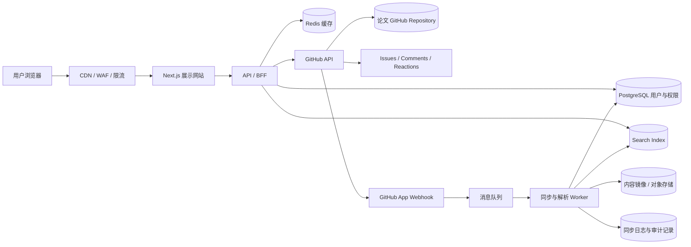
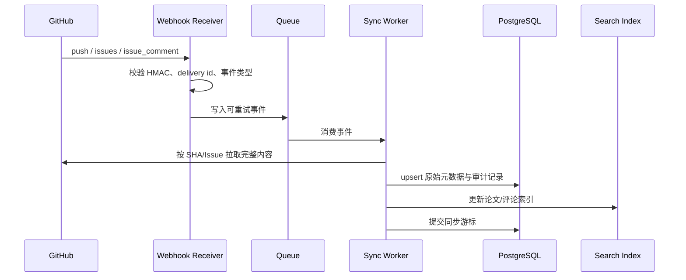

# 基于 GitHub 的论坛风格 ArXiv 网站技术设计

版本：v1.0  
日期：2026-10-20  
状态：待需求确认

## 1. 设计目标

本方案将 GitHub 作为论文文本、评论和修改历史的内容基础设施，将本项目实现为一个独立的论文展示与搜索网站：

- 用户通过 GitHub 登录。
- 论文主体以 Markdown 文件存放在 GitHub 仓库中。
- 论文讨论、评论和回复使用 GitHub Issue / Issue Comment。
- 用户在网站中阅读、浏览、索引和搜索，不要求每次访问都实时请求 GitHub。
- 所有内容修改可通过 commit、PR、Issue 时间线追溯。
- 早期采用单仓库、单应用，后期可以迁移到多仓库、镜像仓库或独立内容存储。

关键结论：**GitHub 适合作为内容源和审计源，不适合作为千万级用户网站的在线查询数据库。** 网站必须维护自己的只读索引和用户业务数据库，并通过 Webhook/定时同步保持一致。

## 2. 产品边界

### 2.1 第一阶段包含

- GitHub 登录与邀请制白名单。
- 论文 Markdown 提交、审核、发布和版本历史。
- 论文元数据：标题、摘要、作者、分类、关键词、许可证、来源链接。
- 论文详情页、分类页、作者页、排行榜和全文搜索。
- GitHub Issue 作为论文讨论区。
- GitHub Issue Comment 作为评论和回复。
- 网站内展示 GitHub 评论、点赞/表情反应、作者和时间线。
- GitHub Webhook 同步、搜索索引、缓存和后台审核队列。

### 2.2 暂不包含

- 将 GitHub Issue 直接当作高并发聊天系统。
- 论文 PDF 二进制文件直接提交到 Git 仓库。
- 复杂的实时协同编辑。
- 用网站数据库覆盖或篡改 GitHub 原始历史。

## 3. 推荐总体架构



### 3.1 推荐技术栈

| 层 | 技术 | 说明 |
|---|---|---|
| 展示网站 | TypeScript + Next.js App Router + React | 适合 SEO、服务端渲染、论文详情页和静态缓存。 |
| API/BFF | Go + chi 或 TypeScript NestJS | 统一封装 GitHub API、用户权限、搜索和缓存；推荐 Go 作为长期后端。 |
| GitHub 集成 | GitHub App + Octokit | 细粒度权限、短期安装令牌、Webhook 和服务端自动化。GitHub 官方也建议优先考虑 GitHub App，而不是传统 OAuth App。 |
| 用户登录 | GitHub OAuth 2.0 / GitHub App User Authorization | 只申请读取身份所需的最小权限；网站自己的用户表保存 GitHub user ID。 |
| 用户/权限数据库 | PostgreSQL | 保存本地账号、邀请、角色、同步状态、审核状态和站内设置。 |
| 搜索 | OpenSearch 或 Elasticsearch | 论文标题、摘要、Markdown 正文、作者、分类和评论索引。早期可先用 PostgreSQL FTS。 |
| 缓存 | Redis | 热门论文、搜索结果、GitHub API 响应、限流和同步幂等键。 |
| 消息 | Kafka/Redpanda；MVP 可用 Redis Streams | 解耦 Webhook、Git 同步、解析、索引和通知。 |
| 内容镜像 | S3-compatible Object Storage | 保存已同步 Markdown 快照、渲染产物和备份，不作为首要编辑源。 |
| 部署 | Docker + Terraform；规模化后 Kubernetes | 保持云厂商可替换。 |
| 可观测性 | OpenTelemetry + Prometheus + Grafana | 跟踪 GitHub API、Webhook、同步延迟和索引延迟。 |

## 4. GitHub 仓库设计

### 4.1 推荐早期仓库布局

```text
papers-repo/
├── papers/
│   ├── 2026/
│   │   └── 01JABC-paper-slug/
│   │       ├── paper.md
│   │       ├── metadata.yml
│   │       └── assets/
│   └── index.yml
├── schemas/
│   ├── paper-metadata.schema.json
│   └── comment-policy.md
├── .github/
│   ├── ISSUE_TEMPLATE/
│   │   ├── paper-discussion.yml
│   │   ├── paper-report.yml
│   │   └── correction.yml
│   └── workflows/
│       └── validate-papers.yml
└── README.md
```

`paper.md` 是人类可读的正文；`metadata.yml` 是机器可验证的元数据。论文目录使用不可变 ID，不使用标题作为唯一键，标题变化不会改变 URL。

### 4.2 Markdown 约定

```markdown
---
id: 01JABC...
title: "论文标题"
authors:
  - name: "作者姓名"
    orcid: "可选"
categories: [cs.AI]
keywords: [retrieval, agents]
license: CC-BY-4.0
language: zh-CN
source_url: "https://arxiv.org/abs/..."
status: published
---

# 摘要

论文正文……
```

CI 校验以下内容：Schema、必填字段、ID 唯一性、Markdown 安全、链接格式、禁止脚本标签、文件大小和目录命名。

### 4.3 二进制文件

PDF、图片和补充数据不建议直接进入普通 Git 历史：

- 论文正文和元数据进入 GitHub 仓库。
- PDF 进入 S3-compatible 对象存储，Markdown 中保存稳定 URL 和 SHA-256。
- 如果确实需要 GitHub 托管附件，使用 Git LFS 或 Release Assets，并设置大小边界。
- 对象存储文件做版本控制和定期清单备份，避免 Git 历史无限膨胀。

## 5. GitHub 登录与权限

### 5.1 登录方式

推荐使用 GitHub App 的用户授权能力；如果只需要登录且不需要代表用户写 GitHub 内容，也可以使用 GitHub OAuth App。GitHub 文档说明 GitHub App 具有细粒度权限和短期令牌，更适合长期集成。

登录流程：

1. 用户点击“使用 GitHub 登录”。
2. 网站跳转 GitHub 授权页，使用 `state` 和 PKCE 防止 CSRF/授权码劫持。
3. 服务端交换授权码，获取 GitHub user ID、login、头像和邮箱状态。
4. 本地按不可变 `github_user_id` 建立或关联账号。
5. 检查邀请、封禁、角色和组织资格。
6. 创建短期网站 Session；不在浏览器暴露 GitHub App 私钥或长期令牌。

### 5.2 GitHub App 权限

建议初始只申请：

- Repository contents：Read；需要机器人提交时才开启 Write。
- Issues：Read/Write，用于创建 Issue、评论、标签和反应。
- Metadata：Read。
- Webhooks：订阅 `push`、`issues`、`issue_comment`、`installation`。

安装令牌默认短期有效，服务端需要自动刷新并缓存；令牌不可写入日志。

### 5.3 本地权限模型

GitHub 身份不等于网站权限。网站维护：

- `USER`：登录、阅读、参与讨论。
- `INVITED_USER`：邀请制已通过验证。
- `AUTHOR`：提交论文或修改论文。
- `MODERATOR`：处理举报和隐藏内容。
- `ADMIN`：仓库配置、用户管理和系统设置。

论文是否可发布由网站审核状态和仓库 PR 状态共同决定，不能仅根据 GitHub 文件是否存在判断。

## 6. 论文提交与修改溯源

### 6.1 推荐工作流：PR 优先

1. 用户在网站填写标题、摘要、作者和正文。
2. 网站生成分支和标准目录，调用 GitHub API 创建文件或提交 PR。
3. GitHub Actions 执行 schema、链接、安全和格式检查。
4. 作者或审核员在 PR 中修改、讨论和批准。
5. 合并到默认分支后，GitHub `push` Webhook 触发同步。
6. Worker 解析 commit，更新本地索引，论文变为 `published`。

这样每次修改都有：作者、时间、commit SHA、PR、review、修改前后 diff 和发布版本。

### 6.2 修订原则

- 不直接覆盖旧版本；每次合并生成新的 commit 和版本记录。
- 网站展示“当前版本”和“版本历史”。
- 支持按 commit SHA 查看历史版本和 diff。
- 论文下架使用状态和隐藏标签，不立即删除 Git 历史。
- 纠错优先走 PR；紧急违规内容可由管理员关闭 Issue、隐藏网站索引并留下审计记录。

### 6.3 溯源数据

本地表至少保存：

```text
paper_id
repository_id
path
commit_sha
parent_commit_sha
pr_number
github_author_id
published_at
synced_at
content_sha256
```

网站页面展示 GitHub 原始链接、commit 链接、PR 链接和最后同步时间，并允许用户跳转到 GitHub 复核原始证据。

## 7. Issue 作为评论系统

### 7.1 Issue 映射

- 每篇论文创建一个固定 Issue，使用标签 `paper-discussion` 和 `paper:<paper_id>`。
- Issue body 保存论文简介和规则，网站评论区读取 Issue body 及所有 comments。
- 顶级评论使用 Issue Comment；回复使用 GitHub Comment 的引用语法或网站生成的引用标记。
- 举报使用独立 Issue 模板，不和普通讨论混在一起。
- 评论排序由网站索引完成：时间、热度、未解决问题、作者回复等。

### 7.2 赞踩

GitHub 原生 reactions 适合表达轻量反馈，但不建议把它直接当作唯一的“踩”数据源。推荐：

- “赞”映射到 GitHub `+1` reaction。
- “踩”使用网站的本地投票表，或使用明确的 Issue Comment 命令并由机器人同步。
- 网站展示 GitHub reactions 与本地投票的来源和更新时间。

如果产品必须完全依赖 GitHub，则只能使用现有 reactions，不能假设 GitHub Issue 原生提供独立的“踩”语义。

### 7.3 限制

GitHub Issue 不适合作为高频计数、实时排序和强一致反垃圾系统。因此：

- 写入 GitHub 前先通过网站限流、反滥用和权限检查。
- 网站只读缓存 GitHub 评论，不让每次页面刷新调用 GitHub API。
- Webhook 丢失时通过定时 reconcile 拉取 Issue 增量。
- 评论删除、锁定和举报状态在本地保存审计记录。

## 8. 同步与索引

### 8.1 事件流



Webhook 只负责快速接收和入队，不在 HTTP 请求中完成全文解析或搜索写入。

### 8.2 一致性策略

- GitHub 是内容源，PostgreSQL 是本地状态和索引元数据源。
- 搜索是最终一致的；页面显示索引更新时间。
- 每个事件以 `delivery_id` 幂等处理。
- 每个仓库保存 `last_seen_commit_sha`；事件顺序异常时重新扫描 commit 范围。
- 每小时或每天执行 reconcile，发现 Webhook 丢失时补偿同步。
- 第一次接入仓库执行全量扫描，之后使用 Webhook 增量同步。

### 8.3 搜索索引字段

```text
paper_id, title, abstract, markdown_plain_text,
authors, categories, keywords, language, license,
github_repo, commit_sha, published_at,
comment_count, score, last_activity_at
```

评论可以作为独立索引文档，并通过 `paper_id` 关联。搜索结果展示“正文命中”或“评论命中”，避免用户误以为评论属于论文正文。

## 9. 网站 API

```text
GET  /v1/papers?query=&category=&author=&cursor=
GET  /v1/papers/{paperId}
GET  /v1/papers/{paperId}/versions
GET  /v1/papers/{paperId}/diff?from=&to=
GET  /v1/papers/{paperId}/discussion?cursor=&sort=
POST /v1/papers/{paperId}/discussion/comments
POST /v1/papers/{paperId}/vote
POST /v1/papers/{paperId}/report
GET  /v1/auth/github/start
GET  /v1/auth/github/callback
GET  /v1/me
```

所有列表使用 cursor pagination；接口返回 `source_url`、`commit_sha`、`synced_at` 等溯源字段。前端不直接拼装 GitHub API 响应，避免以后替换内容源时重写页面。

## 10. 数据模型

```text
users
  id, github_user_id, login, role, status, created_at

papers
  id, repo_id, path, title, status, current_commit_sha,
  current_version_id, github_issue_number, published_at

paper_versions
  id, paper_id, commit_sha, parent_sha, pr_number,
  content_sha256, object_key, author_github_id, created_at

comments
  id, paper_id, github_comment_id, author_github_id,
  body_snapshot, status, created_at, updated_at

votes
  id, paper_id, user_id, value, source, created_at,
  UNIQUE(paper_id, user_id)

sync_events
  delivery_id, event_name, repo_id, payload_hash,
  status, retry_count, processed_at
```

评论正文保存快照和 GitHub URL，既便于搜索，也保留指向 GitHub 的可验证来源。快照不是对 GitHub 的替代，出现冲突时以 GitHub 当前内容和事件历史为准。

## 11. 扩展到数千万用户

### 11.1 必须提前做的事

- 页面读取走网站缓存和搜索索引，不走 GitHub API。
- GitHub API 调用集中在同步 Worker，并按 installation token 做配额管理。
- 论文正文、评论和聚合字段全部落本地只读索引。
- 搜索结果、热门论文和评论列表做 CDN/Redis 缓存。
- Webhook 事件进入可重放队列，允许多 Worker 水平扩展。
- 网站用户、会话、限流和反滥用不依赖 GitHub Issue。

### 11.2 后续拆分边界

```text
Identity Service       GitHub 登录、邀请、角色
Content Sync Service   仓库、PR、commit、Markdown 同步
Discussion Service     Issue、Comment、reaction 映射
Search Service         论文与评论索引
Moderation Service     举报、风控、下架、审计
Web Read API           面向网站的高并发读接口
```

拆分时保持 GitHub 事件格式和本地领域事件稳定，旧 API 通过兼容层继续服务。GitHub 仓库数量超过单仓库适用范围后，可按年份、分类或作者组织拆分，但网站中的 `paper_id` 必须保持不变。

## 12. 安全与治理

- Webhook 使用 HMAC `X-Hub-Signature-256` 校验，拒绝重复 `delivery_id`。
- GitHub App 私钥放在 Secret Manager，禁止写入仓库、日志和前端。
- Markdown 渲染采用白名单 HTML，禁止脚本、内联事件和危险 URL 协议。
- Issue 评论显示 GitHub 原作者、创建时间、编辑状态和来源链接。
- 提交、评论、举报、下架、恢复和同步失败都写审计日志。
- 对用户输入做长度、链接、频率和重复内容限制；必要时延迟发布或人工审核。
- 处理版权投诉时，网站先隐藏展示和搜索结果，再保留 GitHub/审计证据，按流程决定仓库内容是否下架。

## 13. 可靠性与运维

建议初始目标：

- 网站阅读可用性：99.9%。
- Webhook 接收成功率：99.99%。
- 内容同步延迟 P95：5 分钟以内。
- 搜索索引延迟 P95：10 分钟以内。
- 搜索不可用时，论文详情仍可按 `paper_id` 从 PostgreSQL/对象存储降级读取。

监控指标：GitHub API 配额、Webhook 延迟、事件积压、同步失败、全量 reconcile 差异数、搜索延迟、缓存命中率、页面错误率、评论反滥用命中率。

## 14. 实施阶段

### MVP

GitHub 登录、邀请白名单、一个论文仓库、Markdown 论文、PR 校验、Issue 讨论、Webhook 同步、论文展示、基础搜索和版本链接。

### Beta

OpenSearch、评论索引、分类/作者页、论文版本 diff、举报流程、管理员后台、Redis 缓存、定时 reconcile、S3 镜像和可观测性。

### Scale-ready

GitHub App 安装管理、事件队列多消费者、仓库分片、读 API 独立扩容、搜索集群扩展、多区域对象存储、灾备恢复演练和内容源迁移工具。

## 15. 主要风险与决策

| 风险 | 处理方式 |
|---|---|
| GitHub API 限流或短暂不可用 | 本地索引、缓存、队列、重试和 reconcile；页面不实时依赖 GitHub。 |
| Issue 不适合复杂评论排序 | Issue 是内容源，本地数据库/搜索索引负责查询、聚合和排序。 |
| Git 仓库体积持续增长 | Markdown 与元数据入 Git，PDF/附件入对象存储；限制大文件。 |
| GitHub 用户身份变化 | 使用不可变 GitHub user ID 关联，login 仅作为展示字段。 |
| GitHub 服务或策略变化 | 内容镜像、标准 Markdown、事件日志和抽象接口保证可迁移。 |
| “踩”没有完全匹配的 GitHub 原生语义 | 本地投票作为事实来源，或明确降级为 reactions，不伪造 GitHub 数据。 |

## 16. 待确认问题

1. 论文是否必须由用户直接提交到项目仓库，还是由平台机器人代提交 PR？
2. 是否接受论文讨论区公开暴露 GitHub Issue URL 和 GitHub 用户名？
3. “踩”是否必须完全写入 GitHub，还是允许网站维护本地投票？
4. 是否需要 PDF 原文、LaTeX 源文件和图片附件？
5. 是否允许 GitHub 组织/机构账号作为作者身份？
6. 论文仓库是公共仓库、私有仓库，还是公共内容仓库 + 私有审核仓库？

## 17. 参考资料

- [GitHub OAuth App 授权流程](https://docs.github.com/en/apps/oauth-apps/building-oauth-apps/authorizing-oauth-apps)
- [GitHub App 认证方式](https://docs.github.com/en/apps/creating-github-apps/authenticating-with-a-github-app)
- [GitHub App 安装访问令牌](https://docs.github.com/en/apps/creating-github-apps/authenticating-with-a-github-app/generating-an-installation-access-token-for-a-github-app)
- [GitHub App Webhook API](https://docs.github.com/en/rest/apps/webhooks)
- [GitHub REST API 认证](https://docs.github.com/en/rest/authentication)
- [Next.js App Router](https://nextjs.org/docs/app)
- [OpenTelemetry 官方文档](https://opentelemetry.io/docs/)

