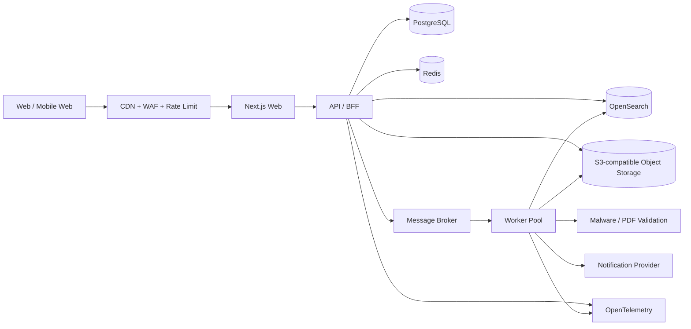

> **已废弃（2026-10-22）**：本文件是早期通用架构草案（Kubernetes / OpenSearch / Kafka / 自建 Worker），
> 不再代表本项目的目标架构。现行方案见
> [基于 GitHub 与 Vercel 的论坛风格 ArXiv 网站技术设计](基于%20GitHub%20与%20Vercel%20的论坛风格%20ArXiv%20网站技术设计.md)。

# 论坛风格 ArXiv 网站技术设计（历史草案）

版本：v0.1
日期：2026-10-19
状态：待需求确认

## 1. 摘要

建设一个以论文为核心内容、以讨论和社区信誉为核心互动方式的学术论坛。用户可以上传论文，系统保存论文原文件和结构化元数据；其他用户可以浏览、搜索、点赞/点踩、发表评论和回复。

产品分两个阶段：

1. **早期邀请制**：用户量和内容量有限，优先保证审核、版权、安全、体验和开发速度。
2. **开放注册及大规模增长**：预计用户达到数千万，读流量、搜索、评论写入、文件下载和反滥用成为主要压力，需要能够拆分服务、水平扩展和迁移数据。

核心原则：

- 论文文件与业务数据库分离；数据库只保存元数据、权限和索引。
- 业务逻辑先模块化单体，稳定后按边界拆服务，避免过早微服务化。
- 所有异步任务可重试、幂等、可观测。
- 数据和基础设施尽量采用开放协议和可替换实现，避免锁定单一云厂商。
- 从第一天开始区分“用户可见状态”和“后台处理状态”，方便审核、迁移和故障恢复。

## 2. 假设与待确认事项

本文先按以下假设设计：

- 论文默认允许公开展示，但上传者必须确认拥有传播权或选择明确的授权协议。
- 支持 PDF 为第一优先格式，后续可支持 LaTeX 源文件、补充材料和版本更新。
- 评论默认公开，支持举报、隐藏、审核和删除；暂不设计私信、付费、实时协同编辑。
- “赞/踩”是每个用户对一篇论文最多一票，可撤销或切换；论文展示净得分及赞踩数。
- 初期部署在单一区域；后续可以迁移到任意兼容 S3 的对象存储和托管 Kubernetes。

需要产品方确认：是否允许匿名评论、是否需要多语言界面、是否需要 DOI/ORCID/机构认证、论文是否需要版本树、是否有地域合规或数据驻留要求。

## 3. 总体架构



### 3.1 推荐技术栈

| 层 | 推荐 | 选择理由与替代方案 |
|---|---|---|
| Web | TypeScript + Next.js App Router + React | SEO、论文详情页、服务端渲染和渐进式交互兼顾；Next.js 官方当前推荐 App Router。替代：纯 React SPA。 |
| API | Go + chi/Fiber + OpenAPI | 并发、资源占用、部署简单，适合文件处理和高并发读写；替代：TypeScript NestJS。 |
| 主数据库 | PostgreSQL 18 | 关系一致性、全文基础能力、分区、逻辑复制和生态成熟；替代：兼容 PostgreSQL 的云数据库。 |
| 缓存/限流 | Redis | 会话、热点论文、幂等键、计数缓冲和限流；不把 Redis 作为唯一事实来源。 |
| 搜索 | OpenSearch | 论文标题、摘要、作者、分类、评论的全文检索与聚合；初期可用 PostgreSQL FTS，达到规模后切换。 |
| 文件存储 | S3-compatible Object Storage | 大文件、版本、生命周期、跨区域复制和 CDN；避免把 PDF 放入 PostgreSQL。 |
| 异步消息 | Kafka 兼容接口（早期可 Redpanda，极早期可 Redis Streams） | 论文解析、索引、通知、反滥用等与请求解耦；事件可重放，方便迁移。 |
| 身份认证 | OIDC/OAuth 2.1 + 邮箱验证码/Passkey | 初期邀请制和后期开放注册可复用；用户表不绑定某个认证供应商。 |
| 部署 | Docker + Terraform + Kubernetes（早期可托管容器/单节点） | 先低成本，后续服务可独立扩容和迁移。 |
| 可观测性 | OpenTelemetry + Prometheus/Grafana + Loki/Tempo | 统一 traces、metrics、logs，供应商中立。 |
| CI/CD | GitHub Actions 或 GitLab CI + 分阶段发布 | 自动测试、迁移检查、灰度和回滚。 |

建议的现实落地方式是：**一个 Go 模块化单体 API + 一个 Worker + 一个 Next.js 应用 + PostgreSQL + Redis + S3 + CDN**。不要一开始拆成十几个微服务。

## 4. 领域模型

主要实体：

- `users`：用户身份、状态、角色、信誉分、创建时间。
- `invitations`：邀请人、邀请码哈希、使用者、过期时间、使用状态。
- `papers`：逻辑论文；标题、摘要、作者快照、分类、可见性、审核状态、当前版本。
- `paper_versions`：论文版本；文件对象键、大小、SHA-256、页数、解析状态、上传者。
- `paper_authors`：作者顺序、姓名、机构、ORCID（可选）。
- `comments`：论文评论或回复；`parent_id`、正文、状态、编辑/删除时间。
- `votes`：`user_id + paper_id` 唯一约束，值为 `1/-1`。
- `reports`：举报对象、举报理由、处理状态和审计信息。
- `moderation_actions`：审核动作不可变记录。
- `outbox_events`：事务内写入的事件，用于可靠投递到消息系统。

关键约束：

- 论文文件用内容哈希去重，但每个逻辑版本仍保留业务记录。
- 评论删除采用软删除，保留审计和回复链完整性。
- 赞踩不直接依赖缓存；数据库保存最终事实，缓存只保存聚合结果。
- 所有用户可见数据带 `status`、`created_at`、`updated_at`，避免使用物理删除作为业务状态机。

## 5. 核心流程

### 5.1 上传论文

1. API 创建上传会话并返回短时效预签名 URL。
2. 浏览器直传对象存储，API 不承载 PDF 字节流。
3. 客户端提交完成；服务端校验大小、扩展名、MIME、SHA-256 和上传者权限。
4. 写入 `paper_versions` 与 `outbox_events`，状态为 `PENDING_SCAN`。
5. Worker 执行病毒扫描、PDF 结构校验、文本提取、首屏缩略图、页数和元数据提取。
6. 通过审核后发布 `paper.published` 事件，异步更新 OpenSearch、缓存和通知。

文件策略：原始文件不可覆盖；对象键使用不可猜测的 UUID/内容哈希；启用对象版本控制、服务端加密、生命周期规则和跨区域备份。S3 的分片上传和版本能力适合大文件及断点续传场景。

### 5.2 浏览与搜索

- 论文详情页由 Next.js 服务端渲染，静态/半静态内容经 CDN 缓存。
- 热门列表使用 Redis 缓存，缓存失效采用 TTL + 主动失效。
- 搜索读取 OpenSearch，论文发布/修改通过事件最终一致地更新索引。
- 论文详情必须能在搜索不可用时降级到 PostgreSQL 按 ID 读取。

### 5.3 评论与赞踩

- 评论写入 PostgreSQL，使用游标分页，不使用深分页 `OFFSET`。
- 评论计数、论文赞踩统计可异步聚合；用户自己的投票状态从事实表读取或短缓存。
- 赞踩接口使用幂等键和唯一约束，防止重复提交。
- 评论内容经过长度、链接、敏感词、频率和反垃圾规则；高风险账号进入人工审核队列。

## 6. API 设计

对外使用版本化 REST API，内部事件使用 CloudEvents 风格；OpenAPI 作为唯一接口契约。

```text
POST   /v1/invitations
POST   /v1/auth/register
GET    /v1/papers?query=&sort=&cursor=
POST   /v1/papers/uploads
POST   /v1/papers/{paperId}/versions
GET    /v1/papers/{paperId}
GET    /v1/papers/{paperId}/comments?cursor=
POST   /v1/papers/{paperId}/comments
PUT    /v1/papers/{paperId}/vote
DELETE /v1/papers/{paperId}/vote
POST   /v1/reports
```

接口响应统一包含 `request_id`；写请求支持 `Idempotency-Key`；列表返回 `next_cursor`。前端、后台管理、未来移动端都通过同一 API，避免把业务逻辑写死在 Next.js 页面中。

## 7. 数据库与扩展路径

### 阶段 A：0–10 万用户

- 单个 PostgreSQL 主库，自动备份和只读副本。
- `comments`、`votes`、`audit_logs` 按月或按 hash/range 预留分区策略。
- PostgreSQL 全文检索即可启动，OpenSearch 作为可选组件。
- 单个 Worker 部署多个并发消费者。

### 阶段 B：10 万–500 万用户

- 读写分离，热点论文和榜单进入 Redis。
- OpenSearch 独立扩容；论文、评论和用户搜索索引分离。
- 评论、投票、通知等写入高峰通过消息队列削峰。
- 论文文件使用 CDN，下载不回源到 API。
- 数据库表按时间/用户哈希分区；引入连接池和查询预算。

### 阶段 C：500 万–数千万用户

- 按领域拆分服务：Identity、Paper、Discussion、Moderation、Search、Notification、Media。
- 论文主数据与互动数据分库；评论/投票按 `paper_id` 或租户/区域做水平分片。
- 通过逻辑复制、CDC 或事件回放迁移数据，保留旧 API 兼容层。
- 热门论文采用边缘缓存和预计算快照；读路径尽量不访问主库。
- 多区域部署时，论文文件和搜索索引可多区域复制；评论写入先选择单主区域，避免一开始承担多主冲突。

PostgreSQL 的声明式分区和逻辑复制为这条路径提供了渐进式迁移能力；但分区键、全局唯一约束和跨分片事务必须在早期约束好。

## 8. 安全、版权与治理

- 全站 HTTPS，Cookie 使用 `HttpOnly/Secure/SameSite`，管理后台强制 MFA。
- 上传文件隔离扫描；禁止服务端主动执行 PDF 内嵌脚本；下载设置 `Content-Disposition` 和安全响应头。
- 预签名 URL 短时效、一次性或绑定对象键；不把对象存储密钥暴露给客户端。
- 邀请码只存哈希；邀请频率、注册 IP、设备指纹和邮箱域名均可限流。
- 角色：`USER`、`TRUSTED_USER`、`MODERATOR`、`ADMIN`；所有后台操作写入审计日志。
- 提供版权投诉、论文下架、申诉和版本替换流程；下架不立即物理删除，以便审计和合法恢复。
- 个人数据导出与删除要与论文署名、评论审计记录分离处理。

## 9. 可靠性与可观测性

最低 SLO 建议：

- 论文详情页可用性：99.9%。
- 上传接口可用性：99.9%；上传后的异步处理时间 P95 小于 5 分钟。
- 评论提交成功率：99.9%。
- RPO ≤ 15 分钟，RTO ≤ 1 小时（早期）；规模化后按成本提升。

必须监控：API 延迟和错误率、数据库连接/锁/慢查询、队列堆积、扫描失败率、搜索延迟、对象存储回源、CDN 命中率、注册转化率、垃圾评论率和举报处理时长。

使用 OpenTelemetry 贯穿 Web、API、Worker 和消息队列；每个上传、发布、评论、搜索请求关联 `request_id` 和 `trace_id`。

## 10. 迁移与供应商解耦

- 所有基础设施用 Terraform；环境变量只保存连接信息，不把云厂商 SDK 调用散落在业务层。
- 文件访问封装为 `ObjectStore` 接口，消息封装为 `EventBus` 接口，搜索封装为 `SearchIndex` 接口。
- 论文元数据和互动数据使用标准 SQL 导出；对象存储定期生成清单、哈希和跨区域副本。
- 数据迁移采用“全量复制 → 增量事件/CDC → 双写校验 → 灰度切流 → 保留回滚窗口”。
- 每季度进行一次恢复演练，验证备份不是“可生成”而是“可恢复”。

## 11. 分阶段交付

### MVP

邀请注册、登录、论文 PDF 上传、审核、论文详情、搜索、评论、回复、赞踩、举报、管理员后台、备份和基础监控。

### Beta

论文版本、作者/机构元数据、通知、OpenSearch、CDN、队列削峰、内容审核、审计日志、导出/删除流程。

### Scale-ready

读副本、分区、事件回放、独立搜索集群、对象存储跨区域复制、服务拆分、灰度发布、灾备演练和容量压测。

## 12. 首批关键决策

1. 采用模块化单体，而不是从第一天开始微服务。
2. PostgreSQL 保存事实数据；Redis、OpenSearch 和消息队列均可重建。
3. PDF 永远走对象存储直传和 CDN 分发。
4. 赞踩使用数据库唯一约束保证正确性，计数可异步化。
5. 通过 Outbox + 可重放事件支持搜索、通知、审核和后续拆服务。
6. 账号、论文、互动、审核之间保持明确领域边界，未来可按边界拆库/拆服务。

## 13. 参考资料

- [Next.js App Router 官方文档](https://nextjs.org/docs/app)
- [PostgreSQL 18 分区表官方文档](https://www.postgresql.org/docs/current/ddl-partitioning.html)
- [Amazon S3 分片上传与版本说明](https://docs.aws.amazon.com/AmazonS3/latest/userguide/mpuoverview.html)
- [OpenTelemetry 官方文档](https://opentelemetry.io/docs/)

